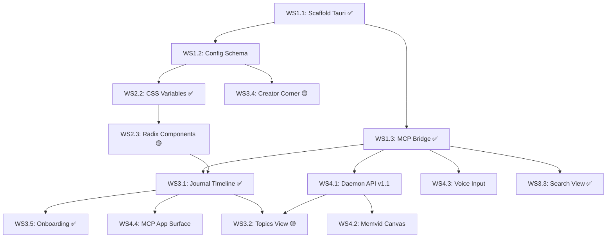

# Terminal Buddy — Phase B Parallel Execution Plan

> **Based on:** Product Spec v2 & BMAD Party Mode Session (2026-02-22)
> **Created:** 2026-02-22T18:13:00-08:00
> **Last Updated:** 2026-02-24T03:00:00-08:00 — Task 6 (Search) + Modular Panel Architecture complete
> **Status:** 🔧 IN PROGRESS — 6/11 tasks complete
> **Architecture:** Multi-Agent / Parallel Workstreams

---

## 📋 Context Preservation Note

This plan encapsulates all decisions from the BMAD Party Mode session, including:

- **Product Wedge:** "A journal for your terminal that explains itself."
- **Core Principle:** "Personalization without complexity."
- **Architecture:** Buddy Daemon (MCP) + UI Layer (Tauri/React) + Memvid Canvas.
- **Key Features:** Journal View (Timeline/Topics), Creator Corner, Accessibility-First Defaults, Multi-Surface (Tauri + MCP App).
- **Session Log:** Preserved at `docs/logs/2026-02-22-BMAD-PARTY-MODE-SESSION.md`.
- **Product Spec:** `docs/specs/2026-02-22-PRODUCT_SPEC_V2.md` (primary reference, 844 lines).

---

## 🏗️ Workstream Architecture (For Parallelization)

To enable simultaneous work by multiple agents (Claude, Gemini, Qwen) or human team members, the project is split into **4 Independent Workstreams**.

| Workstream | Focus | Best Agent Fit | Dependencies |
|------------|-------|----------------|--------------|
| **WS1: Core Infrastructure** | Tauri Scaffold, MCP Bridge, Config Schema | **Claude** (Rust/TS integration) | None — Start Immediately |
| **WS2: Design & Accessibility** | Design System, CSS Variables, Fonts, Radix UI | **Gemini** (Visual/design) | WS1 (Repo Setup only) |
| **WS3: Journal & Creator UI** | Journal Views, Command Cards, Creator Corner | **Claude/Qwen** (Complex React state) | WS2 (Design Tokens) |
| **WS4: Daemon & Integration** | MCP API v1.1, Memvid Canvas, Voice, Testing | **Claude** (Debugging/Integration) | WS1 (MCP Bridge) |

---

## 🚀 Detailed Task Breakdown

### Workstream 1: Core Infrastructure (The Foundation)

*Owner: Lead Architect Agent*
*Goal: Establish the shell, config schema, and MCP connection.*

#### Task 1.1: Scaffold Tauri v2 Workspace ✅ COMPLETE

- [x] Initialize `buddy-app/` using `npm create tauri-app@latest` (React + TypeScript)
- [x] Configure `tauri.conf.json` for Linux/macOS/Windows
- [x] Set up Rust workspace in root `Cargo.toml`
- [x] **GATE: Verify build** — `npm run build` succeeds (1,732 modules, 206KB JS)
- [x] **Deliverable:** Tauri app builds and opens a window

#### Task 1.2: Define Config Schema (Critical Path)

- [ ] Create `shared/config-schema.ts` (JSON Schema for all customizable settings)
- [ ] Define sections: `appearance`, `interaction`, `components`, `voice`, `sessions`
- [ ] Ensure schema matches `buddy.toml` structure in Daemon
- [ ] **Deliverable:** Validated JSON Schema file committed to `shared/`
- [ ] **Blocks:** WS3 (Creator Corner) and WS2 (Theme System)

> **Note:** Config management is partially implemented — `buddy.toml` read/write works via Tauri commands (`load_config`, `save_config`), but no formal JSON Schema yet.

#### Task 1.3: MCP Bridge Implementation ✅ COMPLETE

- [x] Implement Tauri Rust backend command to spawn `buddy-daemon` as child process
- [x] Wire stdio transport between Tauri backend and Daemon
- [x] Create TypeScript MCP client in React (`tauri-mcp.ts` using `@tauri-apps/api/core` invoke)
- [x] Implement `invoke('check_daemon_status')` + all 7 command handlers with mock fallback
- [x] MCP handshake with `initialized` notification
- [x] **Deliverable:** UI displays real data from Daemon (live or mock mode)

#### Task 1.4: LLM Backend ✅ COMPLETE (added post-plan)

- [x] Trait-based `LlmClient` abstraction in `llm/` module
- [x] Anthropic Claude provider (`claude-sonnet-4-5`)
- [x] Google Gemini provider (`gemini-2.0-flash`)
- [x] OpenRouter provider (OpenAI-compatible, default)
- [x] API key resolution: env var → config file → graceful fallback
- [x] Wired into `buddy_explain` and `buddy_ask`
- [x] **Deliverable:** Real LLM calls for explanations and command translation

---

### Workstream 2: Design & Accessibility (The Look)

*Owner: Design System Agent*
*Goal: Build the visual language and accessibility foundation.*

#### Task 2.1: Font & Typography System ✅ COMPLETE

- [x] Integrate fonts: **Atkinson Hyperlegible** (default), **JetBrains Mono** (terminal)
- [x] Set default base size to `18px` (accessibility first)
- [x] CSS variables for all typography tokens
- [x] **Deliverable:** Fonts load correctly in Tauri window

#### Task 2.2: CSS Variable Theme Engine ✅ COMPLETE

- [x] Define `:root` variables in `App.css` for 50+ design tokens (colors, spacing, radii)
- [x] Implement `dyslexia-dark` theme as default (WCAG AAA contrast — 15.4:1 ratio)
- [x] Ensure `prefers-reduced-motion` is respected globally
- [ ] Use **OKLCH** for color values (consistent contrast) — *optional enhancement*
- [x] **Deliverable:** Theme applied consistently across all components

#### Task 2.3: Accessible Component Primitives 🟡 PARTIAL

- [x] Install **Radix UI** (Buttons, Dialogs, Tabs, Switches)
- [x] Focus rings (2px primary blue) on all interactive elements
- [ ] Wrap primitives with theme variables (no hardcoded colors)
- [ ] Verify keyboard navigation (Tab order, Focus rings)
- [ ] **Deliverable:** Reusable `ui/` component library (Button, Input, Card)

---

### Workstream 3: Journal & Creator UI (The Product)

*Owner: Frontend Agent*
*Goal: Build the primary user interface.*

#### Task 3.1: Journal View — Timeline Mode ✅ COMPLETE

- [x] Timeline view with sessions grouped by date
- [x] `CommandCard.tsx` component with Lucide SVG action buttons: Explain, Note, Re-run
- [x] Replaced mock data with real MCP tool responses (daemon returns JSON)
- [x] Date grouping — multiple sessions under one date header
- [x] `ExplanationModal.tsx` — proper modal replaces `alert()`
- [x] Error state with retry button, loading spinner, empty state
- [x] Connection status badge (Live/Demo) in navigation
- [x] **Deliverable:** Timeline renders real data from Daemon ✅

#### Task 3.2: Journal View — Topics Mode ⬜ NOT STARTED (Unblocked)

- [ ] Build `TopicsView.tsx` (sessions grouped by auto-detected subject)
- [ ] Add rename/re-tag functionality (updates via MCP)
- [ ] **Deliverable:** Users can switch between Timeline/Topics tabs with real data
- [ ] **Depends on:** WS4.1 (`buddy_topics`, `buddy_session_classify`)

#### Task 3.3: Journal View — Search Mode ✅ COMPLETE

- [x] Build `SearchView.tsx` with debounced search bar (300ms)
- [x] Call `buddy_history` with query, display filtered results as command cards
- [x] Add date and topic filters
- [x] Search both commands and session titles
- [x] Results grouped by date (Today, Yesterday, etc.)
- [x] **Modular panel architecture** — SearchView is standalone movable panel
- [x] **PanelManager dropdown** — View menu to show/hide/minimize panels
- [x] **Deliverable:** Search returns real results from Daemon, can be shown/hidden/minimized ✅

#### Task 3.4: Creator Corner MVP 🟡 STARTED (Panel Architecture Done)

- [x] Build `CreatorCorner.tsx` landing page (4 options: Skin, Component, Template, Browse)
- [x] Implement Visual Editor (sliders for font size, spacing, contrast)
- [x] Connect editor changes to CSS Variables (live preview)
- [x] Implement "Save as Template" (writes JSON to `~/.terminal-buddy/templates/`)
- [x] **Panel architecture** — All panels minimizable, hideable via PanelManager
- [ ] Add "Reset to Accessible Default" button on every panel
- [ ] **Drag-and-drop layout builder** — panels can be reordered (future)
- [ ] **Deliverable:** User can customize font/theme and save it
- [ ] **Blocks on:** Task 1.2 (Config Schema)

#### Task 3.5: Onboarding Wizard ✅ COMPLETE

- [x] Build `OnboardingWizard.tsx` (first-run only)
- [x] Steps: Welcome (interaction mode), AI Setup (provider + API key), Preferences (font, explain level, TTS)
- [x] "Use Recommended Setup" (one-click) vs "Customize" paths
- [x] Live API key validation via provider endpoints
- [x] Save choices to `buddy.toml` via Tauri config commands
- [x] **Deliverable:** First launch flows smoothly to Journal view in <5 clicks ✅

---

### Workstream 4: Daemon & Integration (The Brain & Voice)

*Owner: Backend/Integration Agent*
*Goal: Extend Daemon API and integrate advanced features.*

#### Task 4.1: MCP API v1.1 Extensions ⬜ NOT STARTED

> **Note:** MCP API v1.0 is FROZEN. These are additive v1.1 tools only.

- [ ] Implement `buddy_session_classify` (auto-title logic)
- [ ] Implement `buddy_topics` (list/create/rename)
- [ ] Implement `buddy_add_note` (store user annotations)
- [ ] Implement `buddy_search_semantic` (SQLite-vec integration)
- [ ] **Deliverable:** New tools visible via `tools/list`

#### Task 4.2: Memvid Canvas Integration ⬜ NOT STARTED

- [ ] Install `@memvid/canvas-react` SDK
- [ ] Replace standard Timeline list with Memvid Canvas component (optional/advanced view)
- [ ] Enable timeline scrubbing (click to replay session state)
- [ ] **Deliverable:** Visual timeline scrubber works in Journal View
- [ ] **Reference:** `docs/references/REF_MEMVID_CANVAS_SDK.md`

#### Task 4.3: Voice Input Engine ⬜ NOT STARTED

- [ ] Integrate `whisper-rs` in Tauri Rust backend
- [ ] Implement Push-to-Talk (RightCtrl hotkey)
- [ ] Stream transcription to UI input bar
- [ ] Add TTS playback for explanations (configurable provider: local, ElevenLabs, Qwen)
- [ ] **Deliverable:** User can speak commands and hear explanations

#### Task 4.4: MCP App Surface (Parallel Build) ⬜ NOT STARTED

- [ ] Create `mcp-app/` directory (standard HTML/JS)
- [ ] Reuse React components from `buddy-app/src/components`
- [ ] Wrap in iframe-compatible container
- [ ] Test inside Claude Desktop / Cursor
- [ ] **Deliverable:** Journal view renders inside MCP host
- [ ] **Reference:** `ext-apps/` SDK at project root

---

## 🔗 Dependency Map (Critical Path)



**Critical path:** ~~WS1.1 → WS1.3 → WS3.1~~ ✅ DONE → ~~WS3.3~~ ✅ DONE → WS4.1 (API v1.1) → WS3.2 (Topics) → WS4.2 (Memvid) → Ship

**Unblocked now:**

- WS3.2 (Topics — partial, needs WS4.1 for full topic tools)
- ~~WS3.3 (Search — fully unblocked, `buddy_history` already supports query)~~ ✅ DONE
- WS4.1 (Daemon API v1.1 — no blockers)
- WS4.3 (Voice Input — no blockers)
- WS3.4 (Creator Corner — panel architecture done, needs config schema)

---

## 🤖 Agent Assignment Strategy

| Agent | Role | Workstream | Key Instruction |
|-------|------|------------|-----------------|
| **Claude** | Lead Architect | **WS1 + WS4** | Focus on Rust/TS integration, MCP protocol correctness, and Daemon API extensions. Ensure type safety across the boundary. |
| **Gemini** | Design Partner | **WS2** | Focus on visual implementation, CSS variables, accessibility contrast ratios, and font rendering. Verify WCAG AAA compliance. |
| **Qwen** | UI Logic | **WS3** | Focus on React component state, Creator Corner logic, template serialization, and Onboarding flow. Ensure no state leaks. |

**Coordination Protocol:**

1. **Shared Context:** All agents must read `docs/specs/2026-02-22-PRODUCT_SPEC_V2.md` first.
2. **Interface Contract:** WS1 must commit `config-schema.ts` before WS2/WS3 begin styling.
3. **Merge Strategy:** WS2 and WS3 can merge independently to `dev` branch. WS4 merges after WS1 completes MCP bridge.

---

## ✅ Definition of Done (Phase B Alpha)

1. **Installable:** `npm run tauri build` produces a signed binary for Linux
2. **Accessible:** Default font is Atkinson Hyperlegible, contrast passes WCAG AAA ✅
3. **Connected:** UI displays real data from `buddy-daemon` via MCP ✅
4. **Customizable:** Creator Corner allows font/theme changes that persist
5. **Journal-First:** Primary view is Timeline/Topics, not raw terminal ✅
6. **Onboarding:** First-run wizard completes in <5 clicks ✅
7. **Modular UI:** Panels can show/hide/minimize via View dropdown ✅
8. **North Star Met:** User can open app, see last Tuesday's history by topic, click Explain

**Progress: 6/8 criteria met.** Remaining: installable binary, Creator Corner persistence, topic grouping.

---

## 📂 File Structure Target

```
terminal-buddy/
├── buddy-daemon/           # WS4 (Phase A — modify only for bugs or new MCP tools)
│   └── src/llm/            # LLM provider module (Claude, Gemini, OpenRouter) ✅
├── buddy-app/              # WS1, WS2, WS3
│   ├── src/
│   │   ├── components/     # WS3 (CommandCard, ExplanationModal, OnboardingWizard, CreatorCornerWorkshop)
│   │   ├── Panel.tsx       # ✅ Modular panel container
│   │   ├── PanelManager.tsx # ✅ Dropdown to control panel visibility
│   │   ├── SearchView.tsx  # ✅ Search panel (movable)
│   │   ├── ui/             # WS2 (Radix wrappers, Buttons)
│   │   ├── themes/         # WS2 (CSS variables)
│   │   ├── utils/          # tauri-mcp.ts (MCP client)
│   │   └── App.tsx
│   ├── src-tauri/          # WS1, WS4 (Rust backend, whisper-rs)
│   └── package.json
├── mcp-app/                # WS4 (iframe surface — Phase B.5)
├── shared/                 # WS1 (Config schema, types)
└── Cargo.toml
```

---

## 📋 Reference Documents

| Document | Location | Purpose |
|----------|----------|---------|
| **Product Spec v2** | `docs/specs/2026-02-22-PRODUCT_SPEC_V2.md` | ✅ Primary product reference (844 lines) |
| **Session Handoff** | `docs/plans/2026-02-22-party-mode-session-handoff.md` | Product vision & decisions |
| **Architecture Design** | `docs/plans/2026-02-22-terminal-buddy-architecture-design.md` | Architecture diagrams |
| **Design System v2** | `docs/design/DESIGN_SYSTEM_V2.md` | Colors, fonts, layout, components |
| **Technical Reference** | `docs/design/TECHNICAL_REFERENCE.md` | Tech stack, dependencies, data types |
| **Genesis Report** | `~/_bmad-output/genesis/planning/terminal_buddy_GENESIS_REPORT.md` | Genesis analysis |
| **Memvid Canvas SDK** | `docs/references/REF_MEMVID_CANVAS_SDK.md` | SDK reference |
| **MCP App SDK** | `ext-apps/` | iframe surface SDK |

---

## 🎯 Immediate Next Steps

**Pick from these unblocked tasks:**

| Task | Effort | Impact | Recommendation |
|------|--------|--------|----------------|
| **WS3.2: Topics View** | Medium | High | Core product feature — placeholder exists, needs auto-grouping logic |
| **WS4.1: MCP API v1.1** | Medium | High | Unlocks Notes + Topics (`buddy_topics`, `buddy_add_note`, `buddy_search_semantic`) |
| **WS4.3: Voice Input** | Large | Medium | Differentiator but not on critical path |
| **WS4.2: Memvid Canvas** | Medium | Medium | Visual timeline scrubber, session replay |
| **WS3.4: Creator Corner** | Medium | High | Panel architecture done, needs template persistence + drag-and-drop |

**Recommended:** WS3.2 (Topics) to complete the Journal triad (Timeline ✅, Search ✅, Topics ⬜), then WS4.1 (API v1.1) to unlock Notes functionality.

---

*This plan preserves the full vision of the BMAD Party Mode session while enabling parallel execution.*
*Approved: 2026-02-22 | Last Updated: 2026-02-24T03:00:00-08:00 — Task 6 (Search) + Modular Panel Architecture complete*
