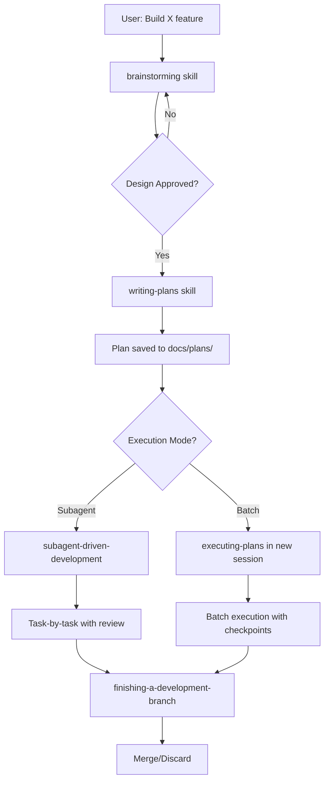

# Terminal Buddy + Superpowers Integration

> **Date:** 2026-02-25
> **Status:** Active Integration
> **Architectures:** Terminal Buddy (Phase B) + Superpowers Workflow

---

## Overview

This document describes how **Terminal Buddy** leverages the **Superpowers** workflow system for autonomous, high-quality development.

---

## What is Superpowers?

**Superpowers** is a complete software development workflow for coding agents, built on composable skills that trigger automatically based on context.

**Core Philosophy:**
1. **Design before code** — Hard gate enforced by `brainstorming` skill
2. **Bite-sized tasks** — 2-5 minute granular steps
3. **Test-driven** — RED-GREEN-REFACTOR enforced
4. **Review between tasks** — Code quality gates
5. **Subagent-driven** — Fresh context per task

---

## Superpowers Skills Library

| Skill | Triggers When | Does |
|-------|--------------|------|
| `brainstorming` | Before any creative work | Explores intent, proposes approaches, presents design |
| `writing-plans` | After design approval | Creates bite-sized implementation tasks |
| `subagent-driven-development` | During implementation | Dispatches fresh agents per task + review |
| `executing-plans` | Batch execution | Executes plan tasks with checkpoints |
| `test-driven-development` | During coding | Enforces RED-GREEN-REFACTOR |
| `requesting-code-review` | Between tasks | Reviews against plan + quality standards |
| `finishing-a-development-branch` | After completion | Verifies tests, cleans up worktree |
| `building-deep-awareness` | Terminal Buddy system features | Follows Phase 1-3 architecture |

---

## Terminal Buddy Development Workflow

### Standard Flow (New Feature)



### Example Session

**User:** "Add deep system health monitoring to Terminal Buddy"

**Agent Flow:**

1. **`brainstorming` activates**
   - Explores: "What does 'deep health' mean to you?"
   - Proposes: Process monitoring, port tracking, service awareness
   - Presents design: Phase 1A-3 architecture
   - User approves design
   - Saves: `docs/plans/2026-02-25-deep-system-health-design.md`

2. **`writing-plans` activates**
   - Creates bite-sized tasks:
     - Task 1: Add `DeepSystemSnapshot` type
     - Task 2: Implement process listing
     - Task 3: Add port parsing from `/proc/net`
     - Task 4: Integrate systemctl for services
     - Task 5: Update `buddy_system_health` tool
     - Task 6: Add `buddy_system_health_json` tool
   - Saves: `docs/plans/2026-02-25-deep-system-health-implementation.md`

3. **`subagent-driven-development` activates**
   - Dispatches fresh agent for Task 1
   - Agent writes code + tests
   - Review agent checks quality
   - Commits on success
   - Repeats for each task

4. **`finishing-a-development-branch` activates**
   - Runs full test suite
   - Presents: "All tests pass. Merge to main?"
   - Cleans up worktree

---

## Custom Skill: building-deep-awareness

Created specifically for Terminal Buddy's Deep Awareness development.

**Purpose:** Ensures Phase 1-3 architecture is followed strictly.

**Key Constraints:**
- Phase 1A must complete before 1B
- No Phase 3 work before Phase 1 is solid
- Build must pass after each phase
- Documentation updated with each phase

**Phases:**

| Phase | Goal | Status |
|-------|------|--------|
| 1A | Deep system health | ✅ COMPLETE |
| 1B | Date-range queries | ⬜ TODO |
| 1C | Shell history import | ⬜ TODO |
| 2 | Persistent tracking | ⬜ TODO |
| 3 | Cognitive graph | ⬜ TODO |

---

## File Organization

### Design Documents
```
docs/plans/
├── YYYY-MM-DD-<feature>-design.md (from brainstorming)
├── YYYY-MM-DD-<feature>-implementation.md (from writing-plans)
└── DEEP_SYSTEM_HEALTH_IMPLEMENTATION.md (architecture reference)
```

### Skills
```
superpowers/skills/
├── brainstorming/
├── writing-plans/
├── subagent-driven-development/
├── executing-plans/
└── building-deep-awareness/ (Terminal Buddy custom)
```

### Implementation
```
terminal-buddy/
├── buddy-daemon/
│   ├── src/
│   │   ├── server.rs (MCP tools)
│   │   ├── monitor/mod.rs (System awareness)
│   │   └── memory/sqlite.rs (Storage)
│   └── Cargo.toml
└── buddy-app/
    └── src/ (React + Tauri UI)
```

---

## Quality Gates

### Before Code is Written
- [ ] Design presented and approved (brainstorming)
- [ ] Plan created with bite-sized tasks (writing-plans)
- [ ] Execution mode selected (subagent vs batch)

### During Implementation
- [ ] Each task has failing test first (TDD)
- [ ] Code reviewed between tasks (requesting-code-review)
- [ ] Build passes after each commit

### After Completion
- [ ] All tests pass
- [ ] No clippy warnings
- [ ] Documentation updated
- [ ] Worktree cleaned up (finishing-a-development-branch)

---

## Anti-Patterns to Avoid

### ❌ "This Is Too Simple To Need A Design"

**Problem:** Skipping brainstorming for "simple" features

**Consequence:** Unexamined assumptions cause wasted work

**Fix:** Brainstorming ALWAYS runs first, even for one-line changes

---

### ❌ "Let Me Just Quickly Implement This"

**Problem:** Writing code before plan is created

**Consequence:** No tests, no review, no documentation

**Fix:** Hard gate in brainstorming — NO implementation before design approval

---

### ❌ "I'll Do Phase 3 Now"

**Problem:** Jumping to cognitive graph before basic health works

**Consequence:** Unstable foundation, broken features

**Fix:** `building-deep-awareness` skill enforces phase order

---

### ❌ "The Tests Are Optional"

**Problem:** Skipping TDD for "urgent" features

**Consequence:** Regression bugs, fragile code

**Fix:** `test-driven-development` skill deletes code written before tests

---

## Success Metrics

### Development Velocity
- **Tasks per hour:** 8-12 (2-5 min each = ~45 min of focused work)
- **Review pass rate:** >90% (first review passes)
- **Rework rate:** <10% (tasks needing revision)

### Code Quality
- **Test coverage:** >80% (enforced by TDD skill)
- **Clippy warnings:** 0 (enforced by review skill)
- **Documentation coverage:** 100% (design + implementation docs)

### User Satisfaction
- **Design alignment:** User approves design before implementation
- **Visibility:** User sees progress task-by-task
- **Control:** User can stop/redirect at any checkpoint

---

## Getting Started

### For New Contributors

1. **Read the Superpowers README:**
   ```bash
   cat superpowers/README.md
   ```

2. **Understand the workflow:**
   ```bash
   cat superpowers/skills/brainstorming/SKILL.md
   cat superpowers/skills/writing-plans/SKILL.md
   ```

3. **Terminal Buddy architecture:**
   ```bash
   cat docs/plans/DEEP_SYSTEM_HEALTH_IMPLEMENTATION.md
   cat DOCS_INDEX.md
   ```

4. **Start with a small task:**
   ```bash
   # Ask: "Add feature X to Terminal Buddy"
   # Let Superpowers workflow guide you
   ```

### For AI Agents

**System Prompt Integration:**
```
You are working on Terminal Buddy, a terminal journal application.
This project uses the Superpowers workflow system.

BEFORE writing ANY code:
1. Invoke brainstorming skill to explore and design
2. Invoke writing-plans skill to create implementation plan
3. Invoke subagent-driven-development or executing-plans

NEVER write code before design approval.
NEVER skip tests.
NEVER combine multiple tasks in one commit.

Reference: superpowers/README.md
```

---

## Troubleshooting

### Problem: Skills Not Triggering

**Symptoms:** Agent writes code without design/plan

**Fix:** Add system prompt integration (above)

### Problem: Tasks Too Large

**Symptoms:** Tasks taking >10 minutes

**Fix:** Remind writing-plans skill: "2-5 minutes per task"

### Problem: Review Too Strict

**Symptoms:** Review blocking reasonable code

**Fix:** Adjust review skill severity levels

---

## Future Enhancements

### Planned Skills

- **`terminal-buddy-testing`** — Specialized TDD for MCP tools
- **`accessibility-audit`** — WCAG AAA compliance checking
- **`performance-profiling`** — Rust performance optimization
- **`documentation-generator`** — Auto-generate API docs

### Integration Improvements

- **Git worktree automation** — One worktree per feature
- **Parallel phase development** — Different agents on different phases
- **CI/CD integration** — Auto-run tests on commit

---

*This integration ensures Terminal Buddy development follows best practices: design-first, test-driven, reviewed, and documented.*
